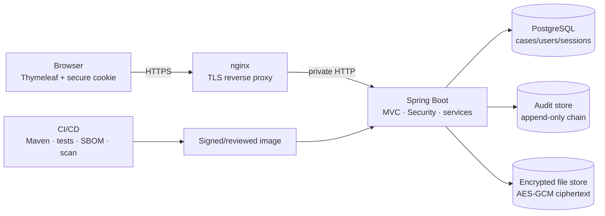

# Architecture

CaseVault is a server-rendered Spring MVC system. Browser requests enter nginx over TLS; nginx forwards only to the Spring Boot application. The application owns authentication, service-layer object authorisation, validation, audit creation and encrypted evidence handling. PostgreSQL holds business, session and audit tables; the file store holds only generated-name ciphertext. CI/CD builds, tests and scans an immutable image before deployment.



Layers follow `web -> service -> repository -> domain`. Controllers accept DTOs only; services own `AccessPolicy` decisions and are the only route to repositories/storage. Auditor administration is deliberately separate from content access. Public endpoints are minimal; actuator exposes health only.

## Login sequence

```mermaid
sequenceDiagram
 participant U as Browser
 participant N as nginx
 participant A as Spring Boot
 participant D as PostgreSQL
 U->>N: POST /login + CSRF token
 N->>A: proxied TLS request
 A->>A: rate limit, generic validation
 A->>D: read enabled user + password hash
 A->>A: Argon2id verify / progressive delay
 A->>D: create JDBC session; audit attempt
 A-->>N: rotate session cookie or generic failure
 N-->>U: Secure HttpOnly SameSite cookie
```

## Evidence upload and download sequences

```mermaid
sequenceDiagram
 participant U as Authorised browser
 participant A as App service
 participant D as PostgreSQL
 participant F as Encrypted file store
 U->>A: POST evidence + CSRF
 A->>A: rate limit, DTO/object check, extension+Tika+size
 A->>A: SHA-256; Tink AES-GCM; generated name
 A->>F: ciphertext only
 A->>D: evidence metadata + audit event
 A-->>U: success, no storage path
```

```mermaid
sequenceDiagram
 participant U as Authorised browser
 participant A as App service
 participant D as PostgreSQL
 participant F as Encrypted file store
 U->>A: GET evidence UUID
 A->>D: metadata + service object check
 A->>F: read ciphertext
 A->>A: Tink decrypt; verify metadata integrity
 A->>D: append audit event
 A-->>U: attachment; nosniff
```

## Report approval sequence

```mermaid
sequenceDiagram
 participant M as Case manager
 participant A as App service
 participant D as PostgreSQL
 M->>A: approve report + CSRF
 A->>D: load report/case/actor
 A->>A: manager scope; reject self-approval
 A->>D: persist approval + chained audit event
 A-->>M: sanitised approved report
```
