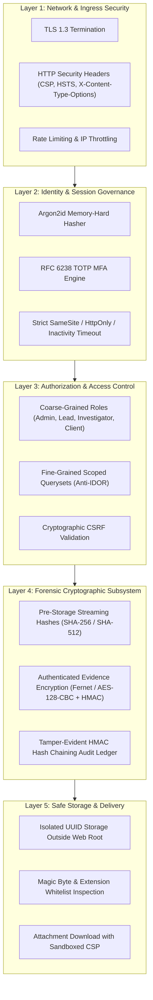
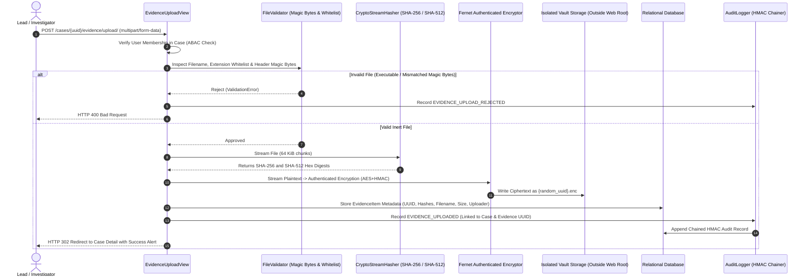

# System Architecture & Security Design: CaseVault

**Organization:** Northbridge Cyber Response  
**System:** CaseVault Forensic Incident Management Platform  
**Module:** CYS22301 Software and Platform Security (Level 6)  

---

## 1. Architectural Philosophy & Principles

CaseVault is engineered following the fundamental security engineering principles outlined by Saltzer and Schroeder:
1. **Economy of Mechanism:** Keep designs simple, idiomatic, and readable. Standard framework primitives (Django ORM, Django authentication backend, Django CSRF middleware) are preferred over complex bespoke code.
2. **Fail-Safe Defaults:** Permissions default to denial; unauthorized or non-existent direct object lookups return HTTP 404; MFA is required before session elevation.
3. **Complete Mediation:** Every access to cases, notes, or evidence files is intercepted and authorized server-side on every request.
4. **Least Privilege:** Database and container execution run as an unprivileged service user (`casevault`). Role assignments restrict users strictly to authorized tasks.
5. **Separation of Privilege:** Multi-factor authentication requires both knowledge (password) and possession (TOTP token). External client auditors cannot execute investigator operations.
6. **Defense in Depth:** Multiple independent layers of protection ensure that the failure of any single control does not result in total compromise.

---

## 2. Layered Defense-in-Depth Model

CaseVault is structured into five distinct, concentric protective rings:

---

## 3. Cryptographic Key Hierarchy & Management

CaseVault maintains a clear, segregated cryptographic key hierarchy to ensure domain separation and zero cross-contamination of secrets:

| Key Identifier | Algorithm / Format | Storage Location | Rotation & Lifecycle Policy | Purpose |
|---|---|---|---|---|
| **`DJANGO_SECRET_KEY`** | 64-char URL-safe pseudorandom string | Environment Variable (`DJANGO_SECRET_KEY`) | Rotated upon major releases or compromised credentials. | Cryptographic signing of session cookies and CSRF tokens. |
| **`CASEVAULT_EVIDENCE_KEY`** | 32-byte URL-safe base64 key | Environment Variable (`CASEVAULT_EVIDENCE_KEY`) | Key versioning supported via Fernet multi-key keyring. | Authenticated symmetric encryption and decryption of evidence payloads at rest. |
| **`CASEVAULT_AUDIT_HMAC_KEY`** | 32-byte (64 hex characters) cryptographic key | Environment Variable (`CASEVAULT_AUDIT_HMAC_KEY`) | Dedicated HMAC key; separate from encryption and session keys. | Generating tamper-evident HMAC-SHA256 digests across the audit chain. |
| **`TOTP_USER_SECRET`** | 32-character base32 secret | Encrypted column in database per user | Generated per user upon MFA enrollment; revokable upon reset. | RFC 6238 TOTP verification code computation. |

---

## 4. Evidence Ingestion & Custody Pipeline

The evidence processing pipeline ensures that no weaponized or tampered file can compromise the server, client browsers, or legal evidence admissibility:

---

## 5. Tamper-Evident Audit Hash Chaining Mechanics

To satisfy the non-repudiation and accountability requirements for digital forensics:
1. Every record $R_i$ contains an HMAC digest $H_i$:
   $$H_i = \text{HMAC-SHA256}_{K_{\text{audit}}}\left(H_{i-1} \parallel T_i \parallel U_i \parallel A_i \parallel M_i \parallel O_i \parallel D_i\right)$$
   Where:
   - $H_{i-1}$ is the hash of the preceding record ($H_0 = 0^{64}$ for genesis)
   - $T_i$ is the ISO 8601 UTC timestamp
   - $U_i$ is the Actor ID
   - $A_i$ is the Action Code (e.g. `EVIDENCE_DOWNLOADED`)
   - $M_i$ is the Target Model (e.g. `EvidenceItem`)
   - $O_i$ is the Target Object ID
   - $D_i$ is the deterministic JSON serialization of event metadata
2. If an adversary deletes row $k$, modifies $R_k$, or injects an unauthorized record, the recalculation of $H_j$ for all $j \ge k$ fails, immediately identifying the exact index of tampering.

---

## 6. Viva Defense Guide: Key Architectural Choices

- **Why Argon2id over PBKDF2/Bcrypt?**  
  Argon2id won the Password Hashing Competition (PHC) and is recommended by OWASP and NIST SP 800-63B. It resists both side-channel cache attacks (unlike Argon2d) and GPU-accelerated brute-force attacks (unlike PBKDF2, which lacks memory-hardness).
- **Why Fernet authenticated encryption over raw AES-GCM?**  
  Fernet implements AES-128-CBC with PKCS7 padding and HMAC-SHA256 authentication, signed with timestamping and IV randomness. It prevents ciphertext tampering, bit-flipping attacks, and key misuse through a standardized, verified Python implementation without requiring custom crypto design.
- **Why UUIDs over auto-incrementing integers?**  
  Sequential integers reveal business metrics (how many cases exist) and facilitate automated enumeration attacks (IDOR scanning). UUIDv4 provides 122 bits of cryptographically secure entropy, making ID guessing statistically impossible.
