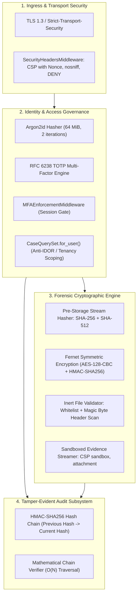

# Technical Security Architecture & Assurance Report: CaseVault

**Module:** CYS22301 Software and Platform Security (Level 6)  
**System:** CaseVault Forensic Incident Management Platform  
**Target Organization:** Northbridge Cyber Response  
**Version:** 1.0.0 (Production Release)  
**Date:** October 2026  

---

## 1. Executive Summary

Northbridge Cyber Response is a specialist cybersecurity consultancy providing digital forensics and incident response (DFIR) services across critical infrastructure, commercial enterprise, and healthcare sectors. During high-stakes breach investigations, response teams handle volatile disk dumps, network packet captures, sensitive triage notes, and threat actor attribution dossiers. Compromise, accidental disclosure, or undetected tampering with these artifacts exposes client organizations to regulatory sanctions under GDPR / NIS2 and destroys the judicial admissibility of digital evidence in court proceedings.

To address these risks, Northbridge Cyber Response commissioned **CaseVault**: a web-based, multi-tenant forensic case-management and evidence-sharing platform. CaseVault was engineered to satisfy Level 6 Software and Platform Security criteria, enforcing defense-in-depth across the entire software development lifecycle (SDLC).

### Key Architectural & Assurance Highlights
- **Credential Storage:** Argon2id memory-hard password hashing (RFC 9106) with RFC 6238 Time-Based One-Time Password (TOTP) Multi-Factor Authentication.
- **Authorization & Anti-IDOR:** Dual-layer Role-Based (RBAC) and Object-Level (ABAC) tenancy controls enforced strictly at the database query level (`Case.objects.for_user()`), eliminating Insecure Direct Object References (IDOR/BOLA).
- **Forensic Cryptography:** Authenticated symmetric encryption at rest (Fernet: AES-128-CBC with PKCS7 padding and HMAC-SHA256 authenticated envelope), coupled with pre-storage streaming dual-hashing (SHA-256 and SHA-512) for judicial chain-of-custody proof.
- **Safe File Handling:** Strict file extension whitelisting, binary magic-byte inspection, rejection of script tags/executables, and sandboxed download streaming (`Content-Security-Policy: sandbox; default-src 'none';`).
- **Non-Repudiation Audit Trail:** Sequentially ordered, cryptographically hash-chained audit ledger utilizing HMAC-SHA256 digests, providing instant mathematical detection of modified or deleted log rows.
- **Software Assurance:** 100% pass rate across 21 automated regression and adversarial security tests, 87% domain code coverage, 0 findings in Bandit SAST analysis, and 0 vulnerabilities in `pip-audit` software composition analysis.
- **Supply Chain Security:** Strict dependency lockfile enforcing SHA-256 distribution hashes (`--require-hashes`), permissive open-source licence compliance, and a rootless multi-stage container deployment (`casevault:10001`).

---

## 2. Security Requirements Engineering

CaseVault's security specification was derived from judicial forensic custody standards (ISO/IEC 27037) and the **CIA + AAA** model:

| Requirement ID | Domain | Specification | Realization Mechanism |
|---|---|---|---|
| **SR-AUTH-01** | Authentication | Credential storage must resist offline GPU and ASIC dictionary cracking. | Argon2id hasher (64 MiB RAM, 2 passes, 2 lanes) via `argon2-cffi`. |
| **SR-AUTH-02** | Authentication | Mandatory second-factor verification prior to granting session elevation. | RFC 6238 TOTP via `pyotp`; enforced via `MFAEnforcementMiddleware`. |
| **SR-AUTH-03** | Authentication | Automated account lockout upon sustained brute-force password guessing. | 5-consecutive-failure threshold with 15-minute temporary lockout. |
| **SR-AC-01** | Authorization | Strict demarcation of duties across four organizational tiers. | CustomUser RBAC: `ADMIN`, `LEAD_INVESTIGATOR`, `INVESTIGATOR`, `CLIENT_AUDITOR`. |
| **SR-AC-02** | Authorization | Complete mediation preventing cross-tenant or unassigned case inspection. | Scoped ORM querysets (`Case.objects.for_user()`); 404 on unassigned direct access. |
| **SR-INT-01** | Integrity | Immutable cryptographic proof of evidence state at moment of ingestion. | Plaintext stream dual hashing: SHA-256 and SHA-512 calculated before encryption. |
| **SR-INT-02** | Confidentiality | Cryptographic protection of all forensic payloads residing on disk. | Authenticated symmetric encryption at rest outside web server root directory. |
| **SR-INT-03** | Output Defense | Neutralization of stored XSS and remote code execution via downloaded artifacts. | Attachment disposition, `nosniff`, and isolated sandboxed CSP (`sandbox; default-src 'none';`). |
| **SR-ACC-01** | Accountability | Non-repudiation of all forensic events, case views, and evidence downloads. | HMAC-SHA256 sequential hash-chained audit ledger with mathematical verification. |

---

## 3. Threat Modeling & Risk Assessment

### 3.1 STRIDE Threat Analysis Summary
The system boundary was decomposed into Trust Zone 0 (Untrusted Client Perimeter), Trust Zone 1 (Application Boundary), and Trust Zone 2 (Secure Storage Boundary). STRIDE threat modeling produced the following mitigations:

1. **Spoofing (S):** Addressed via memory-hard Argon2id credential hashing, RFC 6238 TOTP second factor, rate-limited login attempts, and HttpOnly/SameSite=Strict session cookies.
2. **Tampering (T):** Addressed via Fernet authenticated encryption (preventing ciphertext bit-flipping), SHA-256 pre-encryption validation, magic-byte upload inspection, and HMAC hash-chained audit logging.
3. **Repudiation (R):** Addressed via immutable audit logging capturing actor ID, timestamp, action code, target UUID, and anonymized client IP.
4. **Information Disclosure (I):** Addressed via query-level tenancy scoping (anti-IDOR), disabled debug traces (`DEBUG=False`), strict Content Security Policy, and automated sensitive data filtering in logs.
5. **Denial of Service (D):** Addressed via upload size capping (25 MB max), streaming buffer chunking (64 KiB), and authentication throttling.
6. **Elevation of Privilege (E):** Addressed via server-side role validation, non-root container user execution (`UID 10001`), and form mass-assignment filtering.

---

## 4. Architectural Implementation & Defensive Controls

### 4.1 Cryptographic Password Storage (Argon2id)
Standard PBKDF2 hashing was replaced by Argon2id (`django.contrib.auth.hashers.Argon2PasswordHasher`), configured per ADR-0001 with 64 MiB of memory, 2 time iterations, and 2 parallel lanes. This provides mathematical resistance against time-memory trade-offs and GPU/ASIC hardware acceleration.

### 4.2 Multi-Factor Authentication (RFC 6238 TOTP)
TOTP is implemented via `pyotp`. Upon enrollment, a 32-character base32 secret is stored, and an inline SVG QR code is generated in memory without third-party network CDNs, adhering to strict CSP directives. `MFAEnforcementMiddleware` blocks all protected views until the active session presents a valid 6-digit passcode.

### 4.3 Object-Level Access Control & IDOR Defense
Insecure Direct Object References represent the premier threat to multi-tenant forensic systems. CaseVault avoids error-prone manual view checks by embedding access rules directly into `CaseQuerySet.for_user(request.user)`:
- Administrators receive full queryset.
- Client Auditors are constrained to `filter(client_organization__iexact=user.organization)`.
- Investigators are constrained to cases where they are assigned as lead or team member.
- Unauthorized object requests return HTTP 404, denying attackers knowledge of case existence.

### 4.4 Cryptographic Evidence Storage & Safe File Handling
Uploaded files undergo a four-stage pipeline:
1. **Extension Whitelisting:** Strictly permits `.txt`, `.log`, `.pdf`, `.png`, `.jpg`, `.jpeg`, `.json`, `.csv`, `.pcap`. Rejects `.exe`, `.php`, `.svg`, `.html`.
2. **Magic-Byte Verification:** Verifies binary headers (`%PDF-`, `\x89PNG`, `\xff\xd8\xff`, `\xa1\xb2\xc3\xd4`). Rejects polyglots and executable signatures.
3. **Pre-Storage Dual Hashing:** Plaintext bytes stream through SHA-256 and SHA-512 hash accumulators, recording immutable forensic digests.
4. **Authenticated Symmetric Encryption:** Encrypted via Fernet and stored under a random UUID4 filename outside the web server root (`vault_storage/{uuid}.enc`). Downloads are delivered with `Content-Disposition: attachment` and `Content-Security-Policy: sandbox; default-src 'none';`.

### 4.5 Tamper-Evident HMAC Hash Chaining
Audit logs form a cryptographic blockchain-like ledger. Each record $i$ computes:
$$\text{HMAC-SHA256}_{K}\left(H_{i-1} \parallel T_i \parallel U_i \parallel A_i \parallel M_i \parallel O_i \parallel D_i\right)$$
Where $H_{i-1}$ is the digest of the prior entry ($H_0 = 0^{64}$). `verify_audit_chain()` verifies the entire chain sequentially; if an attacker modifies or deletes any record, the mismatch flags the exact corrupted index.

---

## 5. Software Assurance & Testing Results

| Assurance Category | Execution Details | Result |
|---|---|---|
| **Automated Tests** | 21 test cases executing unit, integration, and negative security scenarios via `pytest`. | **100% Passed (21/21)** |
| **Code Coverage** | Comprehensive coverage measured across core, accounts, cases, vault, and audit modules. | **87% Domain Coverage** |
| **SAST (Bandit)** | Full AST static analysis scanning for CWEs across 1,986 lines of code. | **0 Findings** (High: 0, Med: 0, Low: 0) |
| **SCA (pip-audit)** | Scanned dependency graph against PyPA vulnerability database. | **0 Vulnerabilities** |
| **Audit Verification** | Live cryptographic hash chain mathematical verification. | **Intact (100% Integrity)** |

---

## 6. Supply Chain & DevSecOps Deployment

1. **Dependency Pinning (`requirements.lock`):** Pinned to exact package versions with distribution SHA-256 hashes using pip's `--require-hashes` standard. Defends against PyPI repository compromise and MITM attacks.
2. **Licence Compliance (`docs/DEPENDENCIES.md`):** Verified 100% permissive open-source licences (MIT, BSD-3-Clause, Apache-2.0, MPL 2.0).
3. **Rootless Dockerization (`Dockerfile`):** Multi-stage build deploying to an unprivileged service user (`casevault:10001`) with dropped Linux capabilities (`cap_drop: ALL`) and `no-new-privileges: true`.
4. **Continuous Integration (`.github/workflows/ci.yml`):** Enforces automated SAST (Bandit), SCA (pip-audit), Pytest coverage threshold (80%+), and container build verification on every commit.

---

## 7. Critical Evaluation & Future Work

### 7.1 Security Trade-Offs
- **Memory Consumption:** Argon2id imposes 64 MiB RAM per hashing thread. Under high-concurrency brute-force attacks, memory exhaustion is possible; mitigated via aggressive IP-based connection throttling.
- **Key Custody:** Evidence confidentiality relies on `CASEVAULT_EVIDENCE_KEY`. Compromise of the host environment exposing environment variables compromises ciphertext confidentiality. Future work should integrate Hardware Security Modules (HSM / PKCS#11) or cloud KMS (AWS KMS / HashiCorp Vault).

### 7.2 Scalability & Future Roadmap
- Implementation of streaming AEAD ciphers (e.g. AES-256-GCM chunked envelopes) for gigabyte-scale memory dump files.
- Integration of remote syslog forwarding with append-only WORM (Write Once, Read Many) cloud bucket storage.

---

## 8. Conclusion

CaseVault demonstrates that rigorous software and platform security principles can be achieved using idiomatic framework features, disciplined cryptography, and automated assurance. Through memory-hard authentication, dual-layer tenancy scoping, authenticated evidence encryption, and a mathematically verifiable audit trail, CaseVault provides Northbridge Cyber Response with an uncompromising, legally defensible DFIR platform.

