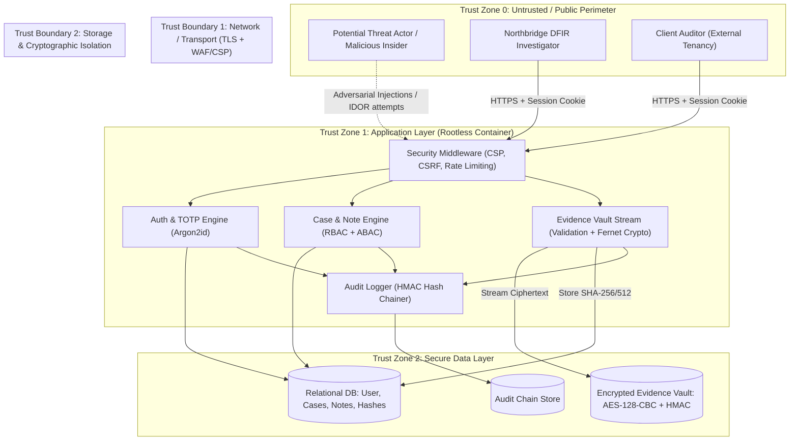
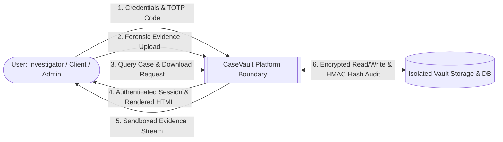
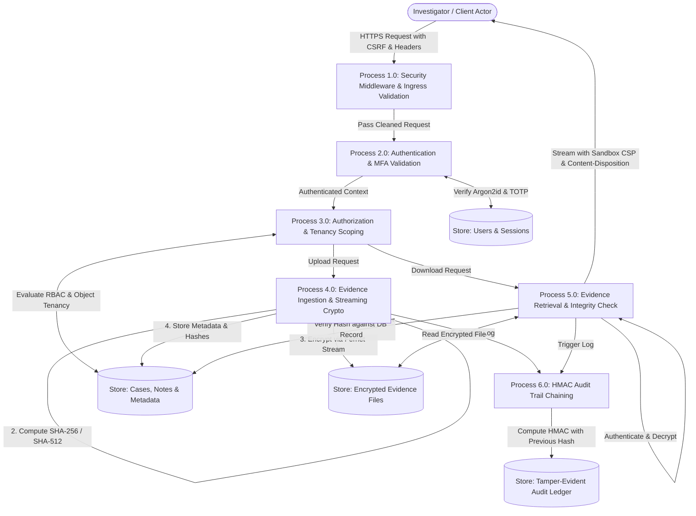

# Threat Model & Risk Assessment: CaseVault

**Organization:** Northbridge Cyber Response  
**System:** CaseVault Forensic Incident Management Platform  
**Methodology:** Microsoft STRIDE Threat Modeling + DFD Analysis  
**Module:** CYS22301 Software and Platform Security (Level 6)  

---

## 1. System Overview & Scope

CaseVault is a multi-tenant web application used by Northbridge Cyber Response incident responders, forensic specialists, engagement managers, and client auditors. The platform processes high-value digital forensic artifacts, investigative notes, indicators of compromise (IOCs), and formal incident reports.

### 1.1 Assets Under Protection
1. **Forensic Evidence Payloads (A1):** Disk images, memory dumps, PCAP network captures, server log extracts. (High Confidentiality, High Integrity).
2. **Case Strategy & Investigative Notes (A2):** Real-time hypothesis, active threat actor attribution, client vulnerability status. (High Confidentiality, High Integrity).
3. **User Credentials & MFA Secrets (A3):** Passwords, TOTP seeds, session tokens. (High Confidentiality, High Integrity).
4. **Audit Trail & Chain of Custody (A4):** Immutable logs documenting who viewed, uploaded, or retrieved evidence for judicial admissibility. (High Integrity, High Non-Repudiation).
5. **System Cryptographic Keys (A5):** Evidence encryption master key (`CASEVAULT_EVIDENCE_KEY`) and HMAC chaining key (`CASEVAULT_AUDIT_HMAC_KEY`). (Critical Confidentiality & Integrity).

---

## 2. Trust Boundaries & Security Zones

The system is partitioned into three distinct Trust Zones:
- **Zone 0 (Untrusted Public / Client Perimeter):** Web browser clients (investigators, external client auditors, network attackers). Communicates exclusively via HTTPS (TLS 1.3).
- **Zone 1 (DMZ / Application Processing Boundary):** Django application server running within a rootless container. Terminates TLS, validates inputs, enforces RBAC/ABAC, manages sessions, and computes cryptographic hashes.
- **Zone 2 (Internal Secure Storage Boundary):** Relational database (PostgreSQL/SQLite metadata store) and encrypted filesystem evidence vault (`vault_storage/`). Inaccessible from the public network.

---

## 3. Data Flow Diagrams (DFD)

### 3.1 DFD Level 0: Context Diagram

### 3.2 DFD Level 1: Decomposed Process Architecture

---

## 4. STRIDE Threat Analysis

| Threat ID | STRIDE Category | Threat Description | Attack Vector / Scenario | Impact | Mitigation in CaseVault | Residual Risk |
|---|---|---|---|---|---|---|
| **T-S01** | **Spoofing** | Adversary attempts to guess or brute-force user credentials to impersonate an investigator. | Automated credential stuffing or online dictionary attack against `/auth/login/`. | High: Unauthorized access to all cases assigned to the victim. | • Argon2id hashing with high memory cost. • Consecutive failure lockout (5 attempts in 15 mins). • Mandatory RFC 6238 TOTP MFA. | Low (dependent on user keeping TOTP device secure). |
| **T-S02** | **Spoofing** | Session hijacking via stolen cookie. | Network eavesdropping or Cross-Site Scripting (XSS) exfiltrating session cookie. | Critical: Attacker assumes active session without credentials. | • `SESSION_COOKIE_HTTPONLY = True` (inaccessible to JS). • `SESSION_COOKIE_SECURE = True` (TLS only). • `SESSION_COOKIE_SAMESITE = 'Strict'`. • Inactivity timeout (15 mins) and regeneration on privilege changes. | Very Low. |
| **T-T01** | **Tampering** | Uploading weaponized files disguised as inert evidence (e.g. polyglot `.php` or SVG with embedded JS). | Malicious actor uploads `exploit.svg` or `shell.php.png` to compromise server or client browser. | Critical: Remote Code Execution (RCE) on server or Stored XSS on investigator browser. | • Strict file extension whitelist (`.txt`, `.pdf`, `.png`, `.jpg`, `.log`, `.pcap`, `.json`). • Magic byte header inspection. • Random UUID storage filename outside web root. • Download served with `Content-Disposition: attachment` and `CSP: sandbox`. | Negligible. |
| **T-T02** | **Tampering** | Malicious insider alters forensic evidence in storage to falsify legal chain of custody. | Direct filesystem manipulation or DB update of evidence files. | Critical: Compromised judicial evidence and legal liability. | • Pre-encryption SHA-256 and SHA-512 calculated in memory. • Stored with authenticated encryption (HMAC in Fernet). • Re-hashed upon download; mismatch immediately halts streaming. | Negligible (requires root key compromise). |
| **T-T03** | **Tampering** | Rogue user deletes or modifies historical audit log entries to conceal unauthorized access. | Direct SQL manipulation or unauthorized API call deleting audit log rows. | High: Undetectable insider abuse. | • HMAC-SHA256 cryptographic hash chaining linking each entry to previous. • Verification routine flags broken chain immediately. • Append-only model enforced by view logic. | Low (tampering is mathematically detected). |
| **T-R01** | **Repudiation** | Investigator denies having viewed, downloaded, or shared sensitive client evidence. | User claims evidence was leaked by another party or accessed without their knowledge. | Medium: Inability to enforce accountability during an internal leak investigation. | • Cryptographically chained audit trail logging every view and download event with actor ID, timestamp, and client IP hash. | Negligible. |
| **T-I01** | **Information Disclosure** | Insecure Direct Object Reference (IDOR / BOLA) allows Client A to view Client B's cases or evidence. | User edits case ID in URL (e.g. `/cases/case-uuid-1/` to `/cases/case-uuid-2/`). | Critical: Breach of client confidentiality and non-disclosure agreements. | • Object-level permission checks in all views. • Querysets strictly scoped to `Case.objects.for_user(request.user)`. • Unauthorized requests return HTTP 404 to avoid enumeration. | Negligible. |
| **T-I02** | **Information Disclosure** | Leakage of stack traces or sensitive credentials via debug logs or error pages. | Exception triggered intentionally by malformed input when `DEBUG=True`. | High: Exposure of database schema, environment variables, or file paths. | • `DEBUG = False` enforced in production. • Custom 400/403/404/500 handlers returning sanitized user messages. • Logging filter strips credentials and tokens. | Negligible. |
| **T-D01** | **Denial of Service** | Resource exhaustion via massive file uploads or algorithmic complexity attacks. | Threat actor uploads gigabytes of data or sends concurrent Argon2 verification requests. | High: Platform crashes or becomes unresponsive to legitimate responders. | • Strict file upload limit (25 MB max). • Stream chunking (64 KiB buffer) preventing memory exhaustion. • Rate limiting on authentication endpoints. | Low. |
| **T-E01** | **Elevation of Privilege** | Standard investigator attempts to execute administrative actions (e.g. creating users, modifying firm policies). | Manipulation of form fields (`role=ADMIN`) or direct navigation to `/admin/` endpoints. | Critical: Full takeover of system governance. | • Server-side role validation on all administrative endpoints. • Role assignments restricted strictly to `ADMIN` role. • Form binding protects role fields from mass-assignment. | Negligible. |

---

## 5. Abuse Cases & Verification Matrix

| Abuse Case ID | Adversary Objective | Adversary Action | Expected System Defense | Verification Test |
|---|---|---|---|---|
| **AC-01** | Bypass MFA | Enters username and password, then directly accesses protected `/cases/` URL without completing TOTP step. | Session marked `mfa_verified = False`; middleware immediately intercepts and redirects to `/auth/mfa-verify/`. | `test_unverified_mfa_cannot_access_cases()` |
| **AC-02** | IDOR Case Tampering | Investigator assigned to Case X attempts to post a note or view evidence in Case Y. | `Case.objects.for_user()` filters out Case Y; request terminates in HTTP 404. | `test_investigator_cannot_access_unassigned_case()` |
| **AC-03** | Stored XSS via File Upload | Attacker uploads `payload.html` containing `` named as `report.pdf`. | Magic byte validator inspects header; identifies HTML content instead of PDF `%PDF`; rejects upload with error. | `test_reject_disguised_html_in_pdf()` |
| **AC-04** | Evidence Tampering Detection | Adversary modifies one byte of encrypted file on disk. | Fernet authenticated decryption detects HMAC signature failure (`InvalidToken`); download view logs tampering event and halts. | `test_tampered_evidence_file_raises_integrity_error()` |
| **AC-05** | Audit Log Deletion Tampering | Adversary deletes an intermediate row in the audit database. | System audit integrity check runs: `verify_audit_chain()` computes chain mismatch at deleted index; returns `is_valid = False` with exact corrupted index. | `test_audit_chain_detects_deleted_record()` |
| **AC-06** | Mass Assignment Escalation | Investigator submits `POST /profile/update/` with form body containing `role=ADMIN`. | Django form whitelist ignores unexpected `role` attribute; user role remains unchanged. | `test_role_mass_assignment_prevented()` |

