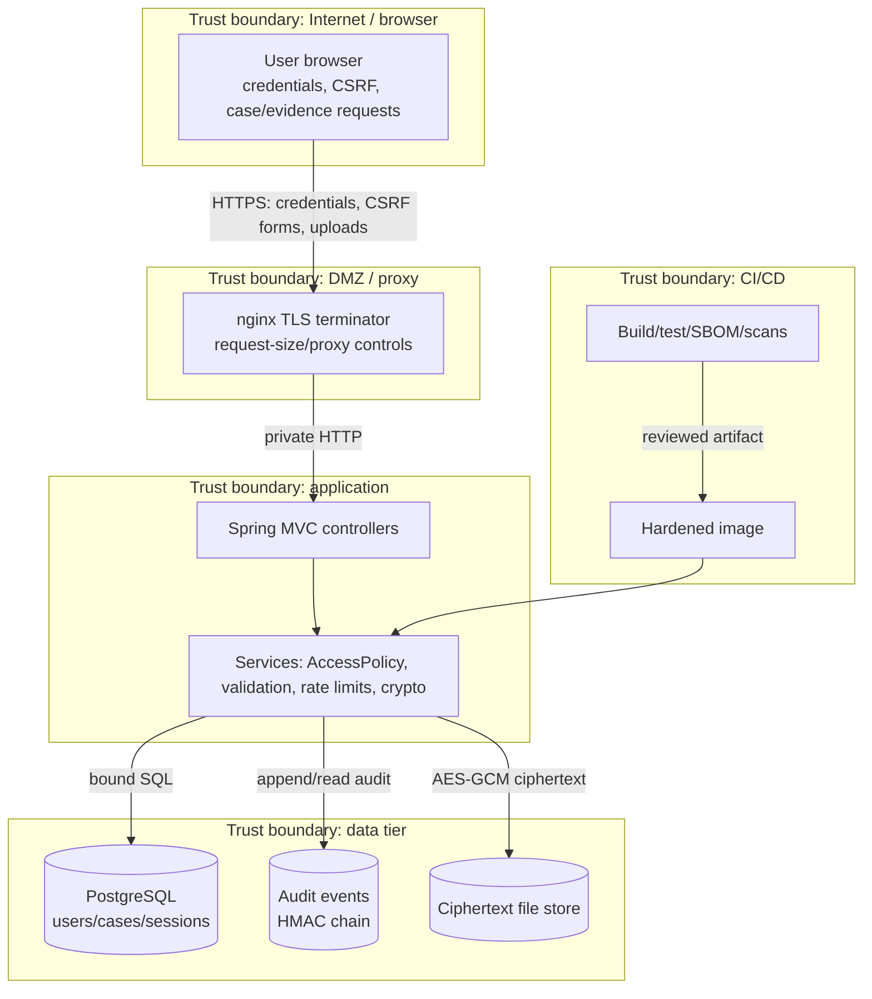
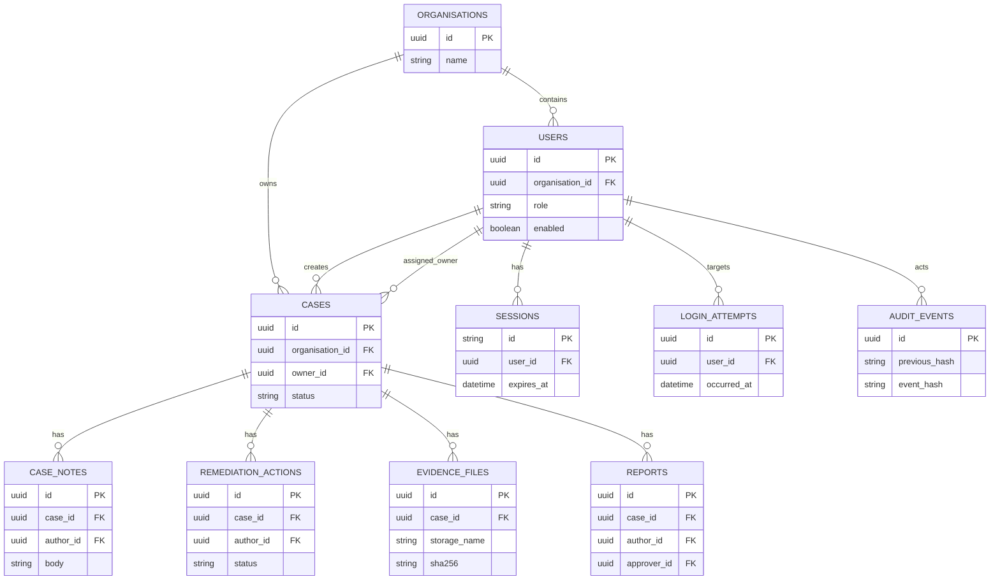

# Level-1 data-flow diagram

Data labels identify the sensitive payload crossing each boundary. Every transition from browser to app is untrusted until server-side validation and authorisation complete.

## Domain model

