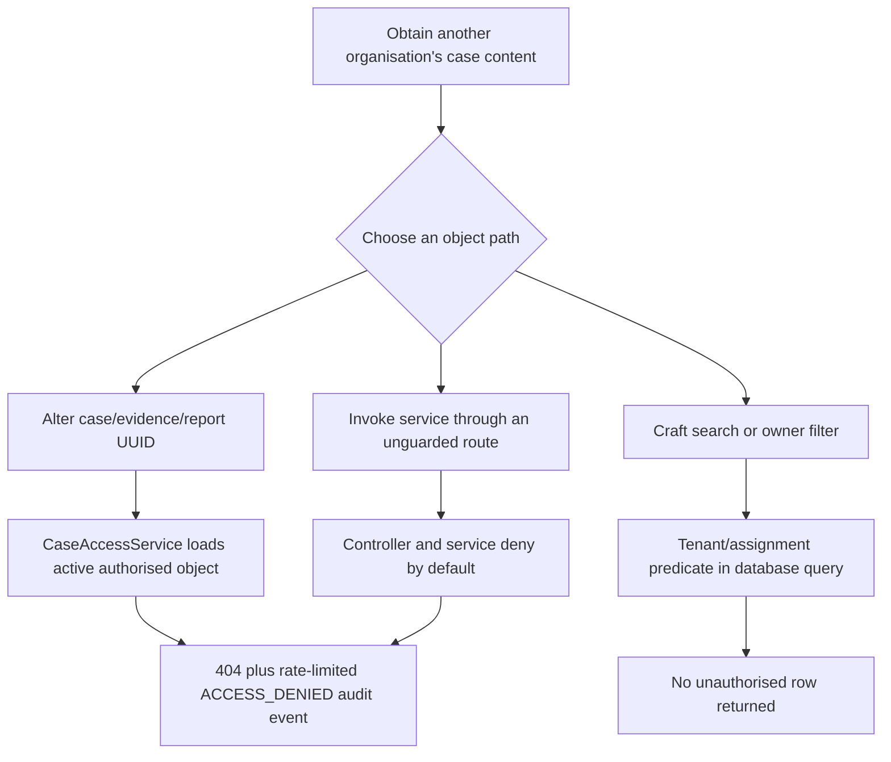
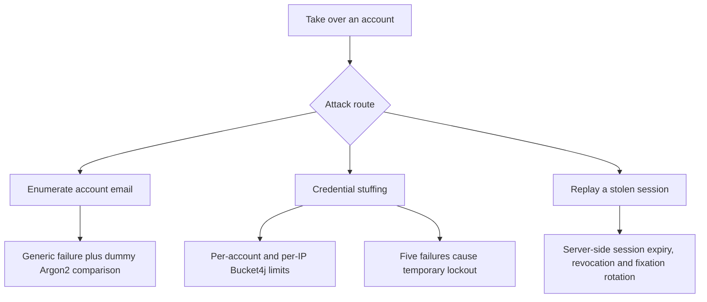
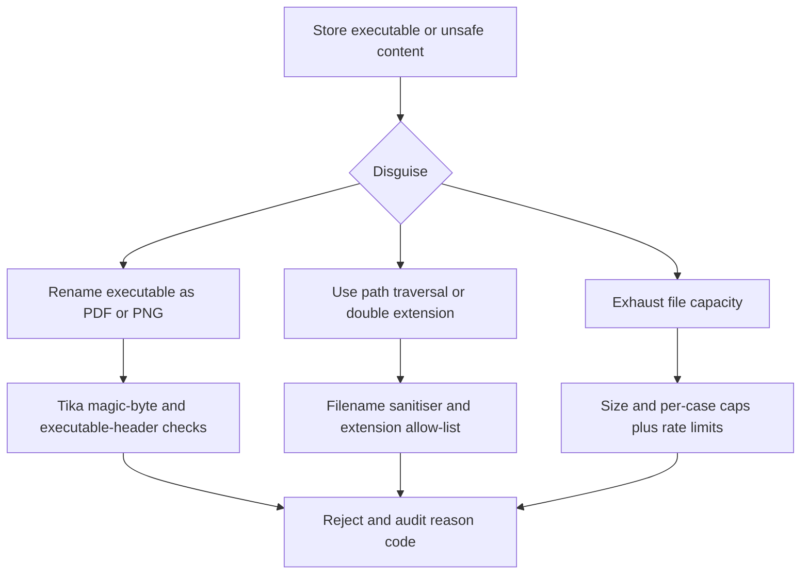
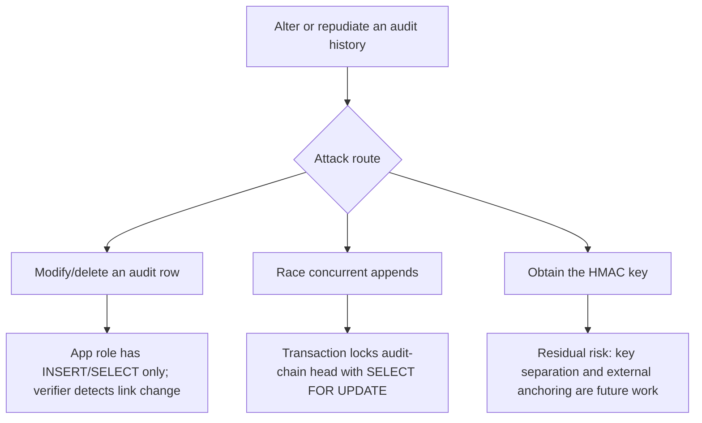
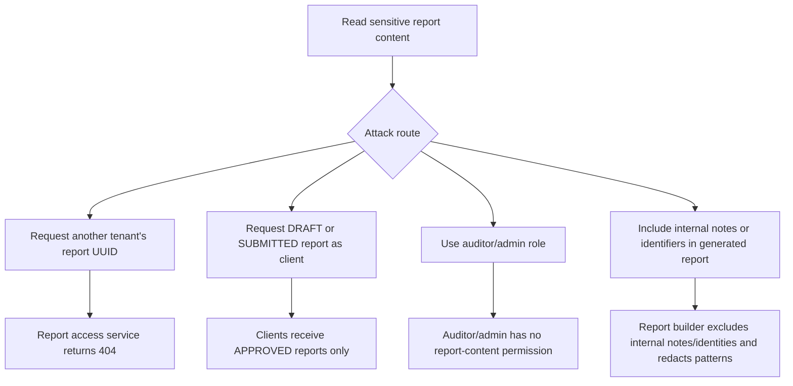

# Threat model

## Method

STRIDE is applied to each element and trust-boundary flow in the level-1 DFD: browser, nginx proxy, Spring Boot application, PostgreSQL, audit store, encrypted file store and CI/CD. This follows Adam Shostack, *Threat Modeling: Designing for Security* (2014). Risk scores prioritise work; they do not claim that risk is eliminated.

## Assets

| Asset | Value | Why |
|---|---:|---|
| Evidence files | Critical | Plaintext is sensitive incident material; ciphertext and its metadata are integrity evidence. |
| Case data | High | Cases, notes, remediation actions and reports contain investigation and remediation records. |
| Credentials | Critical | Password hashes and account state can enable account takeover if mishandled. |
| Session tokens | Critical | A live server-side session token permits impersonation until expiry or revocation. |
| Encryption keys | Critical | The Google Tink keyset can decrypt retained evidence ciphertext. |
| Audit log | Critical | Audit events provide accountability and security-incident evidence. |
| HMAC key | Critical | The audit HMAC key could be used to forge a credible audit-chain history. |

## Top attack paths

The following trees model the five highest-priority attack paths. An OR branch indicates alternative attacker routes; controls shown at leaves are enforcement points, not claims that risk is eliminated.

### A-01: cross-tenant/BOLA disclosure

### A-02: credential takeover

### A-03: disguised evidence upload

### A-04: audit repudiation or chain fork

### A-05: report disclosure

## Risk register

| ID | Threat | STRIDE | Asset | L | I | Score | Priority | Mitigation | Residual risk | Owner |
|---|---|---|---|---:|---:|---:|---|---|---|---|
| R-01 | Cross-tenant/BOLA access | E, I | Case data, evidence files, reports | 4 | 5 | 20 | Critical | SR-03, SR-09 | New service paths can omit a check. | Security lead |
| R-02 | Credential stuffing | S, D | Credentials, session tokens | 4 | 4 | 16 | High | SR-01, SR-02, SR-12 | Distributed attacks and weak user choices remain. | Security lead |
| R-03 | Malicious/disguised upload | T, I, D | Evidence files, encryption keys | 3 | 5 | 15 | High | SR-09 | No live anti-malware scanner. | Storage lead |
| R-04 | Audit tampering/fork | T, R | Audit log, HMAC key | 3 | 5 | 15 | High | SR-11 | DB superuser with HMAC key can forge history; external anchoring is future work. | Audit owner |
| R-05 | XSS/injection | T, I | Session tokens, browser-rendered case data | 3 | 4 | 12 | Medium | SR-04, SR-05, SR-07 | Future rich text needs dedicated policy. | Web lead |
| R-06 | Resource exhaustion | D | Application/storage | 4 | 3 | 12 | Medium | SR-09, SR-12 | Volumetric DDoS exceeds application controls. | Operations |

Priority is derived from score: Critical 20-25, High 15-19, Medium 8-14, Low 1-7.

## Evidence upload residual risk

Evidence upload currently reads a file into memory after the multipart size check and before Tika inspection, scanning, hashing and AEAD encryption. This creates bounded memory pressure under concurrent requests. Mitigations are the 10 MiB application/multipart limits, per-user and per-source-IP Bucket4j quotas, and an aggregated rate-limit audit event. A future streaming pipeline must preserve fail-closed validation ordering and AEAD associated-data binding.

`NoOpScanService` accepts synthetic academic evidence only; it is an integration seam, not anti-malware protection. Archives are blocked by the extension allow-list, so archive/zip bombs are outside current scope.

## Rate-limiting residual risk

Per-IP rate limits reduce automated abuse but can penalise legitimate users behind a shared NAT, VPN gateway or institutional proxy because they consume one shared bucket. In a reverse-proxy deployment, the application must derive a client IP only from a trusted proxy configuration; accepting an arbitrary client-supplied `X-Forwarded-For` header would allow an attacker to spoof the bucket key and bypass the quota. Proxy trust boundaries and forwarding configuration therefore remain an operational responsibility.

## Deployment residual risk

The hardened Compose overlay is a single-host deployment: Docker daemon compromise, host kernel compromise, named-volume theft and an attacker with access to Docker secrets can still expose data or forge audit events. The development certificate is self-signed and therefore deliberately causes browser trust warnings; it is not acceptable for an internet-facing production deployment. Bucket4j quotas remain in-memory per application instance, so limits are not globally shared if the service is scaled horizontally. Production should use a trusted reverse proxy/load balancer, external secret manager, off-host encrypted backups, network monitoring and a distributed quota store where scaling is required.

## CI/CD threat considerations

The delivery pipeline is a distinct trust boundary. A poisoned pull request can attempt to alter workflow files, exfiltrate environment values, replace build outputs or abuse release permissions; branch protection, code review, read-only default `GITHUB_TOKEN`, no `pull_request_target`, event concurrency and tag-only release permissions reduce this risk. Dependency confusion or a compromised Maven repository/action can introduce hostile code; explicit version pinning, Maven strict checksums, Enforcer convergence, SBOMs, Dependabot, SAST/SCA and full-SHA action pinning provide detection and review evidence, not an absolute guarantee. A compromised pinned action commit, hosted runner, GitHub account or maintainer remains a high-impact residual risk. Production releases therefore require protected environments, review of workflow changes, verification of Sigstore bundles/provenance and independent artefact checksum verification before deployment.

## Assumptions and out of scope

Production uses PostgreSQL. H2 is test-only and has different locking semantics; the audit service has an extra in-process guard for H2, while PostgreSQL `SELECT ... FOR UPDATE` remains the cross-instance lock. Host OS/hypervisor compromise, physical theft, nation-state attackers, volumetric DDoS, backup governance and external AV operation are not eliminated by this application.
